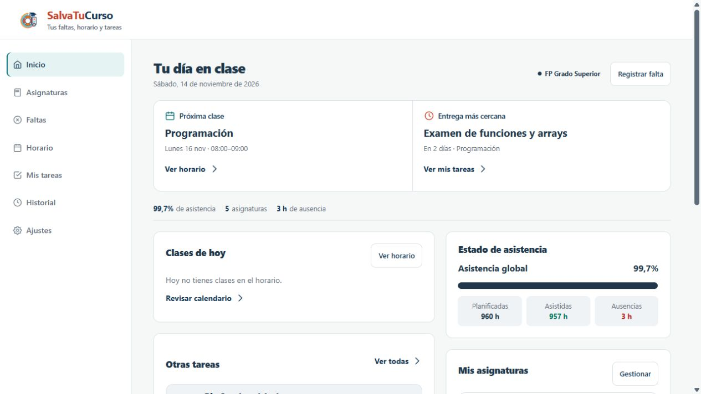
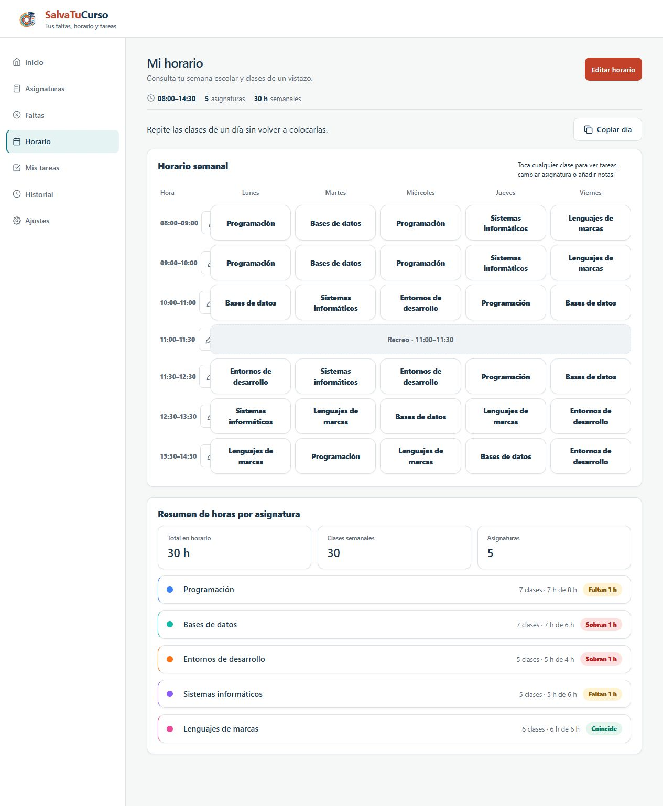
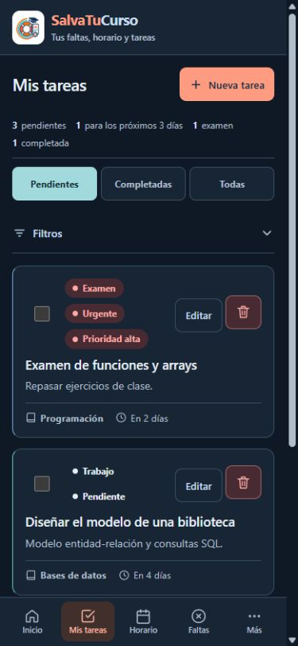

<p align="center">
  
</p>

<h1 align="center">SalvaTuCurso</h1>

<p align="center">Tus faltas, horario y tareas en un solo lugar.</p>

<p align="center">
  <a href="https://salvatucurso.qirris.workers.dev"><strong>Abrir SalvaTuCurso</strong></a>
  · <a href="#instalar-en-el-móvil">Instalar en el móvil</a>
  · <a href="docs/guia-de-uso.md">Guía de uso</a>
  · <a href="https://salvatucurso.qirris.workers.dev/privacidad.html">Privacidad</a>
</p>

SalvaTuCurso te ayuda a organizar el curso: consulta tu próxima clase, prepara los exámenes y lleva un registro de tus faltas. Está pensada para estudiantes de ESO, Bachillerato y Formación Profesional de Andalucía y se adapta al móvil, la tablet y el ordenador.

> **Estado actual:** la app se puede usar sin cuenta o iniciar sesión con cualquier cuenta de Google. La sincronización entre dispositivos y los avisos con la app cerrada están activos. El registro con correo y contraseña sigue aplazado para mantener el servicio gratuito.

## Así se ve

Inicio reúne la próxima clase, la entrega más cercana y el resumen de asistencia.



<table>
  <tr>
    <th>Tu horario semanal</th>
    <th>Mis tareas en el móvil</th>
  </tr>
  <tr>
    <td valign="top"></td>
    <td valign="top"></td>
  </tr>
</table>

Las capturas muestran un curso ficticio preparado para esta presentación. No contienen datos personales ni información de una cuenta real.

## Qué puedes hacer

| Función | Para qué sirve |
| --- | --- |
| **Inicio** | Ver la clase actual o siguiente, las entregas cercanas y el estado de asistencia. |
| **Asignaturas** | Organizar las materias, sus colores y sus horas planificadas. |
| **Horario** | Preparar la semana, cambiar una clase, marcar recreos y copiar un día a otros. En móvil puedes consultarlo por días. |
| **Mis tareas** | Anotar deberes, exámenes, trabajos, proyectos y notas; filtrar las actividades y marcar lo completado. |
| **Faltas** | Registrar una ausencia manual o seleccionar las clases completas que perdiste en un día. La app calcula su duración y avisa de posibles coincidencias. |
| **Historial** | Consultar las faltas en un calendario mensual, revisar sus detalles y editarlas. |
| **Calendario del curso** | Indicar las fechas del curso, los festivos y las vacaciones para que Inicio respete los días sin clase. |
| **Apariencia** | Elegir tema automático, claro u oscuro. |

También puedes recuperar durante unos segundos tareas o faltas con **Deshacer**, descargar copias de seguridad e instalar la app para utilizarla sin conexión después de haberla abierto con internet.

En móvil, la barra inferior da acceso a **Inicio, Mis tareas, Horario, Faltas y Más**. Dentro de **Más** están Asignaturas, Historial y Ajustes.

## Primeros pasos

1. [Abre la app](https://salvatucurso.qirris.workers.dev) y elige tu etapa educativa.
2. Añade tus asignaturas y sus horas planificadas.
3. Coloca las clases en **Horario**. Si lo necesitas, configura festivos y vacaciones en **Ajustes → Calendario del curso**.
4. Añade tus entregas en **Mis tareas** y registra las ausencias desde **Faltas**.

Inicio incluye una guía opcional para preparar el curso. Puedes continuar después y volver a ella desde Ajustes.

## Instalar en el móvil

La app se instala desde el navegador; no necesitas descargarla de una tienda.

**Android con Chrome:** abre [SalvaTuCurso](https://salvatucurso.qirris.workers.dev), entra en **Más → Ajustes → Instalar la aplicación** y pulsa **Instalar aplicación**. Si el navegador no muestra el aviso, usa su menú **Instalar y crear acceso directo → Instalar**. [Ayuda de Chrome](https://support.google.com/chrome/answer/9658361?co=GENIE.Platform%3DAndroid&hl=es).

**iPhone:** abre [SalvaTuCurso](https://salvatucurso.qirris.workers.dev) en Safari, pulsa **Compartir → Añadir a pantalla de inicio** y confirma. Después ábrela desde su icono. Si aparece la opción **Abrir como app web**, déjala activada. [Ayuda de Apple](https://support.apple.com/es-es/guide/iphone/iph42ab2f3a7/ios).

## Dónde se guardan tus datos

| Cómo usas la app | Dónde se guarda el curso |
| --- | --- |
| **Sin cuenta** | En ese dispositivo y navegador. No aparece automáticamente en otro móvil u ordenador. |
| **Con una cuenta de Google** | En Cloudflare y en una copia local del navegador para seguir trabajando sin conexión. La misma cuenta permite compartir el curso entre dispositivos. |

La sincronización incluye asignaturas, tareas y notas, faltas, horario, calendario y configuración académica. El tema, el zoom y los ajustes de avisos se eligen por dispositivo.

Al iniciar sesión con datos ya existentes, puedes revisar qué versión conservar: la del dispositivo o la de la cuenta. Las listas no se mezclan automáticamente. Si dos dispositivos guardan cambios distintos, la app pide revisarlos antes de sustituirlos.

Sin internet puedes seguir usando el curso guardado. Los cambios pendientes se envían cuando vuelve la conexión y la app está abierta. Comprueba el estado de sincronización antes de continuar desde otro dispositivo.

Para guardar una copia, entra en **Más → Ajustes → Tu cuenta y tus datos → Copias y traslado de datos → Descargar copia**. Puedes recuperarla con **Importar copia**. Si usas la app sin cuenta y borras los datos del navegador, necesitarás una copia para recuperarlos.

GitHub contiene el código, la documentación y las capturas de ejemplo. Los cursos de las cuentas se guardan en Cloudflare, separados del repositorio. Las claves privadas no forman parte del código público.

## Avisos de exámenes y entregas

Con una cuenta de Google y el curso sincronizado, ve a **Más → Ajustes → Notificaciones**, elige la antelación y la hora, pulsa **Activar notificaciones** y acepta el permiso en ese dispositivo. **Enviar prueba** permite comprobar la recepción.

Los avisos se programan en el servidor y pueden llegar aunque la app esté cerrada. En iPhone e iPad requieren iOS/iPadOS 16.4 o posterior y abrir la app desde la pantalla de inicio. [Compatibilidad de Web Push en iOS y iPadOS](https://webkit.org/blog/13878/web-push-for-web-apps-on-ios-and-ipados/).

Se usa la última versión del curso sincronizada: un cambio sin conexión no actualiza los recordatorios del servidor hasta enviarse. Los permisos, la conexión y el sistema del móvil pueden retrasar un aviso.

## Para desarrollar

La interfaz usa **HTML, CSS y JavaScript**, con un service worker para el funcionamiento sin conexión. Las cuentas, la sincronización y los avisos usan **Cloudflare Workers, D1, Better Auth y Web Push**.

### Revisar la interfaz localmente

Desde la carpeta del proyecto, con Python instalado:

```bash
python -m http.server 8080 --bind 127.0.0.1
```

Abre `http://localhost:8080`. Esta ejecución estática permite revisar la interfaz y el guardado local; las cuentas y los avisos necesitan el servidor de Cloudflare. Abrir `index.html` directamente no permite comprobar la instalación ni el funcionamiento sin conexión de la PWA.

### Pruebas y preparación

Con Node.js y npm instalados:

```bash
npm ci --ignore-scripts
npm test
npm run build
```

Las pruebas cubren asistencia, temas, calendario, horario, tareas, faltas, recuperación, cuentas y recordatorios. La integración usa servicios locales de prueba, sin enviar correos ni avisos reales. La preparación genera `dist/` con una lista cerrada de recursos públicos.

Para trabajar con el Worker, usa `npm run dev`. Consulta antes la [documentación de Cloudflare](docs/notificaciones.md) para conocer las variables, las migraciones y las condiciones de publicación. Conserva las credenciales fuera del repositorio.

```text
salvatucurso/
├── assets/icons/       # Logo e iconos de instalación
├── cloudflare/         # Servidor y migraciones de la base de datos
├── docs/               # Guía, capturas y documentación de Cloudflare
├── src/css/            # Estilos y temas
├── src/js/             # Interfaz, datos y sincronización
├── tests/              # Pruebas
├── index.html
├── privacidad.html     # Política pública de privacidad
├── manifest.webmanifest
└── service-worker.js
```

## Documentación y alcance

- [Guía de uso: clases, calendario, faltas y recuperación](docs/guia-de-uso.md).
- [Cuentas, sincronización, avisos y publicación en Cloudflare](docs/notificaciones.md).
- [Política de privacidad](https://salvatucurso.qirris.workers.dev/privacidad.html).
- [Fuentes sobre evaluación continua en Andalucía](docs/referencia-normativa-evaluacion-continua-andalucia.txt).

**Cloudflare es la única web publicada.** GitHub Pages está desactivado. Google está en producción para usuarios externos y solicita únicamente nombre, correo e imagen de perfil. El registro con correo y contraseña continúa aplazado.

SalvaTuCurso es una herramienta informativa. Los indicadores de asistencia no determinan si apruebas o suspendes y no sustituyen al centro educativo ni a la normativa oficial. Consulta los criterios de tu centro y las fuentes enlazadas en Ajustes.

